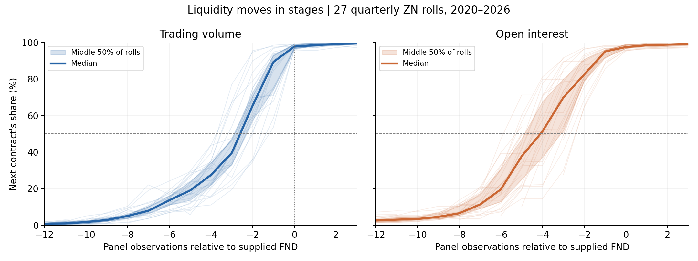
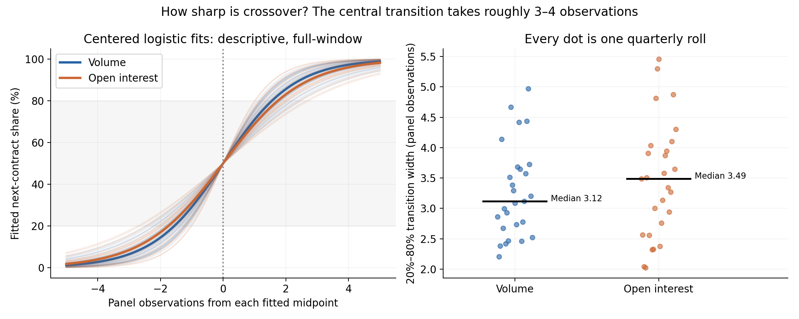
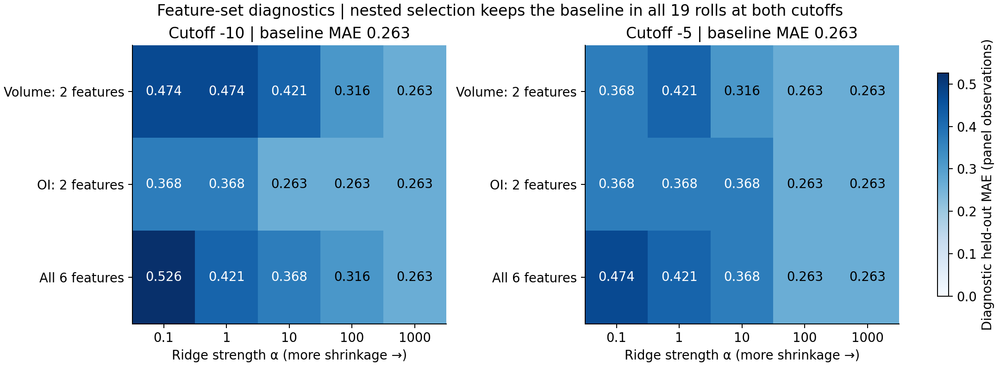
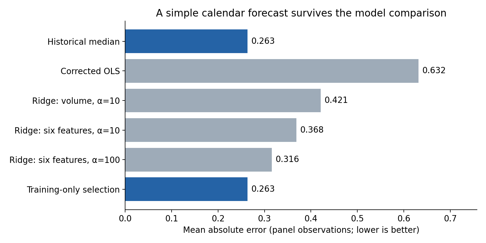
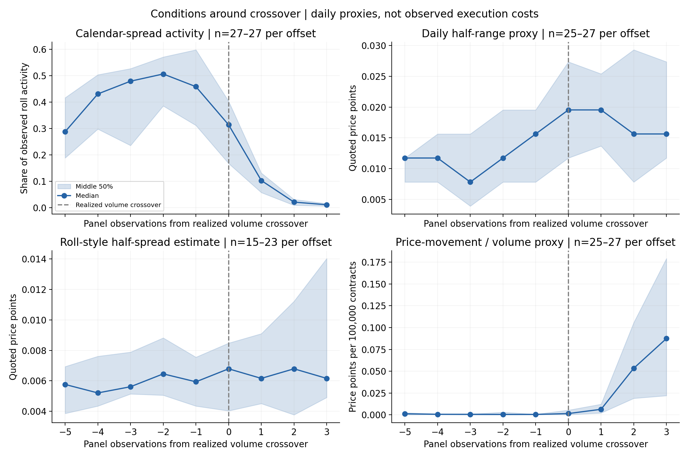
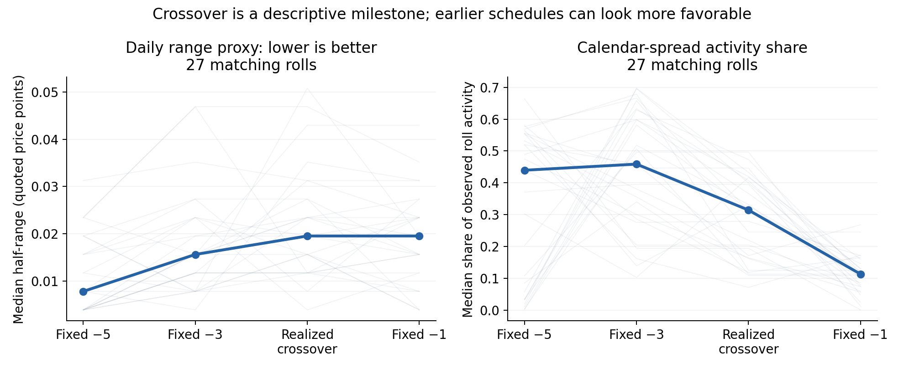

# ZN Roll Liquidity: Predicting the Crossover Is Only Half the Question

**Liquidity migration in 10-Year U.S. Treasury Note futures is regular, but volume crossover does not establish the best time to roll.** Across 27 quarterly ZN rolls from 2020–2026, a historical-median forecast achieves **0.263 panel observations of mean absolute error** on 19 held-out rolls. More elaborate predictors do not improve on it. Open interest usually migrates earlier, and daily execution proxies often favor dates before volume crossover.

Rolling replaces an expiring contract with the next quarterly contract. We study ZN alone to compare how positions, trading volume, and calendar-spread activity migrate, then ask whether predicting that migration helps identify favorable execution conditions.

## Data and the migration process

We use **Databento CME Globex `GLBX.MDP3`** daily OHLCV and open-interest statistics, requested through `ZN.FUT` for January 1, 2020–September 30, 2026. Quarterly front/next pairs produce **837 observations**, indexed −25 through +5 around each supplied First Notice Day (FND).



Open-interest crossover precedes volume crossover in **23 of 27 rolls**, coinciding in four. Volume crosses at −2 in 18 rolls, −3 in five, and −1 in four. This separates the movement of positions from the point when next-contract outright trading becomes dominant.

## Why use volume crossover as the target?

We define crossover as the first observation where next-contract volume exceeds **50% of combined front/next outright volume**. The share normalizes activity across rolls, and 50% marks an interpretable change in trading dominance. It is an observable research milestone; it does not identify the cheapest executable trade. OI crossover tracks positioning separately, while calendar-spread activity may better describe the roll itself. Realized-crossover alignment uses hindsight and is descriptive.

## How sharp is the crossover?

We fit each roll's volume and OI shares with a logistic curve, with midpoint τ and steepness k. The fitted 20%–80% width is **2 ln(4)/k**: median widths are approximately **3.1 observations for volume** and **3.5 for OI**. The transition is concentrated, although daily data cannot resolve its intraday shape. These full-window fits describe migration rather than predict it.



## Feature selection and forecasting methodology

Features represent migration progress, momentum, positioning, and roll activity. We use a small, interpretable set because there are only 27 rolls; additional predictors can fit historical noise.

| Feature | Construction | Economic role |
|---|---|---|
| Next-contract volume share | Next volume / combined outright volume | Progress toward trading dominance |
| Three-observation volume-share change | Current share minus share three observations earlier | Recent migration momentum |
| Five-observation volume-share change | Current share minus share five observations earlier | Broader migration momentum |
| Next-contract OI share | Next OI / combined outright OI | Progress of position migration |
| Three-observation OI-share change | Current OI share minus share three observations earlier | Position-transfer momentum |
| Log spread volume | `log(1 + spread_volume)` | Roll activity, with compressed scale |
| FND-relative index | Recorded panel offset | Calendar-only probability baseline |

Date forecasts use one actual snapshot at or before −10 and at least eight earlier, completed rolls. Within training history, features with insufficient observations or zero variance are excluded; missing values are median-imputed and predictors standardized. No outcome-derived “days until crossover” enters predictors. End-of-observation features cannot select execution on that same observation.

The initial comparison tests volume-only versus all-six ridge specifications. An exploratory grid compares **three feature sets × five ridge strengths**. Chronological inner validation selects the lowest rounded-date MAE using earlier rolls only; ties favor the historical median. Cutoffs −10 and −5 are evaluated separately, without selecting between them from test performance.



The heatmaps show fixed-candidate diagnostics, not permission to choose the best cell retrospectively. Nested selection keeps the historical median for all 19 test rolls at both cutoffs. The grid was designed after examining this historical sample, so it remains exploratory.



| Date forecast at −10 | MAE, panel observations |
|---|---:|
| Historical median | **0.263** |
| Corrected OLS | 0.632 |
| Ridge, six features, alpha 100 | 0.316 |
| Training-only model selection | **0.263** |

Regularization stabilizes OLS without beating the baseline. Separately, calendar-only and lagged-liquidity logistic models predict crossover within one, three, or five observations, evaluated with Brier score and log loss rather than date MAE.

## Could we measure execution costs instead?

Yes: observed calendar-spread bid/ask quotes and available size would support a more direct execution comparison; depth would be needed to assess larger positions. Our downloaded data contains daily prices, volume, and OI, so this project measures **proxies**, not actual spreads, fills, or slippage.

| Available measure | Definition | What it cannot establish |
|---|---|---|
| Daily half-range | Half of spread high minus low | The executable bid/ask spread |
| Roll-style half-spread | Square root of negative trailing price-change autocovariance; missing otherwise | Observed costs; coverage varies |
| Spread activity share | Spread volume / (front + next + spread volume) | Available quoted size or capacity |
| Price-movement / volume | Absolute spread-price change × 100,000 / spread volume | Causal price impact of a trade |



Calendar-spread activity is strongest before crossover, while several proxies deteriorate near or after it. Bands show cross-roll dispersion; observation counts expose incomplete coverage.



Fixed −5 has the lowest median half-range; −3 has the highest median spread-activity share among tested schedules. Other proxy rankings depend on matching the available rolls. This supports questioning crossover as an execution objective, without establishing an optimal date or cost saving.

## Interpretation and limits

The inherited index includes **140 Sunday-labeled rows**, rather than verified CME sessions. Original event/publication timestamps were discarded, leaving holiday alignment and OI availability unresolved. Durations therefore use **panel observations**. The sample is small and repeatedly explored. Session validation and a limited quote-data study are needed before translating these descriptive findings into an execution recommendation.

## How to reproduce

### 1. Install dependencies

Use Python 3.10+ from the repository root:

```bash
python -m venv .venv
source .venv/bin/activate
python -m pip install -r requirements-workflow.txt
```

On Windows PowerShell, activate with `.venv\Scripts\Activate.ps1`.
The workflow dependencies include the model packages and SciPy through
scikit-learn. Raw market data is not committed; a fresh download requires a
Databento account with access to `GLBX.MDP3` and may incur charges.

### 2. Download and prepare the data

```bash
export DATABENTO_API_KEY="your_key_here"
python scripts/run_pipeline.py --dry-run
python scripts/run_pipeline.py
```

On PowerShell, set the key with `$env:DATABENTO_API_KEY="your_key_here"`.
Notebook 01 requests the fixed 2020–2026 window and writes raw Parquet files to
`data/raw/`. It downloads again when rerun. To reuse those files without
calling Databento:

```bash
python scripts/run_pipeline.py --start-at 2
```

The runner executes notebooks 01–06 and `07_predict_crossover.ipynb`, in that
order, with `notebooks/` as the working directory. It creates processed data
and probability-prediction CSVs in `data/processed/`. Notebook outputs are not
saved back by the runner; open and run individual notebooks to view their
inline charts. The download itself has not been repeated for this README revision.

### 3. Reproduce this README's figures and tables

After notebook 02 has produced `data/processed/zn_roll_panel.parquet`:

```bash
python scripts/build_readme_figures.py
```

This offline command rebuilds the standardized panel with
`07_build_standardized_roll_panel.ipynb`, executes
`10_analyze_crossover_geometry_and_costs.ipynb`, and runs the shared timing
comparison and exploratory nested feature grid. It regenerates the six figures in `docs/figures/`
and their supporting CSVs in `docs/tables/`. Intermediate geometry outputs
are in `results/crossover_geometry/`; timing predictions, date audit,
configuration, sensitivity tables, and report are in `results/issue-20/`.
The feature-grid diagnostics and per-roll selections are in
`results/issue-20/grid-search/`; copies of the summary and selections are
included in `docs/tables/` alongside the event-time conditions.
These intermediate directories are git-ignored. The README figures were
regenerated from the cached 27-roll dataset for this revision.

### 4. Explore the remaining analyses

Run all cells of `notebooks/08_test_roll_timing_costs.ipynb` after the pipeline
and standardized-panel step above to compare forecast-timed execution proxies
against benchmark schedules. Notebook 09 displays the timing comparisons and
exploratory extensions; the same calculations are available from the root:

```bash
python -m src.timing_model
python -m src.timing_experiments
python -m src.timing_grid_search
python -m unittest discover -s tests -v
```

See [timing methodology and limitations](docs/issue-20-model-improvements.md)
and [probability-model documentation](docs/issue-7-model.md) for settings and
interpretation. Probability scores and date MAE answer different questions.

### Repository guide

| Path | Contents |
|---|---|
| `notebooks/01`–`06` | Data collection, cleaning, validation, migration, events, and indicators |
| `notebooks/07_predict_crossover.ipynb` | Probability-model evaluation |
| `notebooks/07_build_standardized_roll_panel.ipynb` | Prices and execution proxies |
| `notebooks/08`–`10` | Timing costs, forecast comparisons, and migration geometry |
| `src/` | Reusable prediction and chronological validation code |
| `docs/figures/`, `docs/tables/` | Committed README evidence |
| `scripts/`, `tests/` | Execution helpers and validation |
| `data/`, `results/` | Local market data and generated research outputs |
